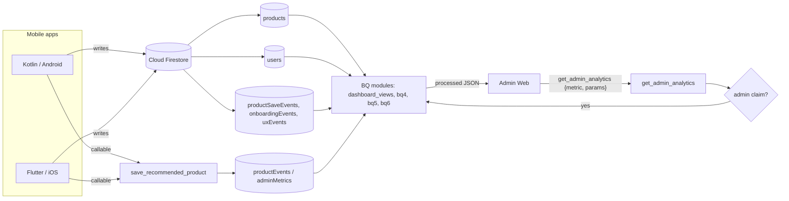
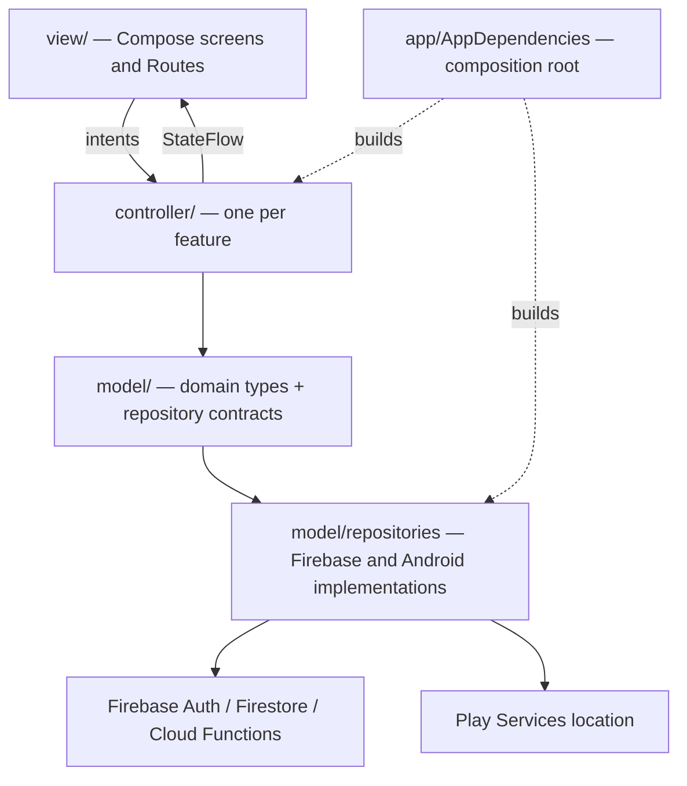
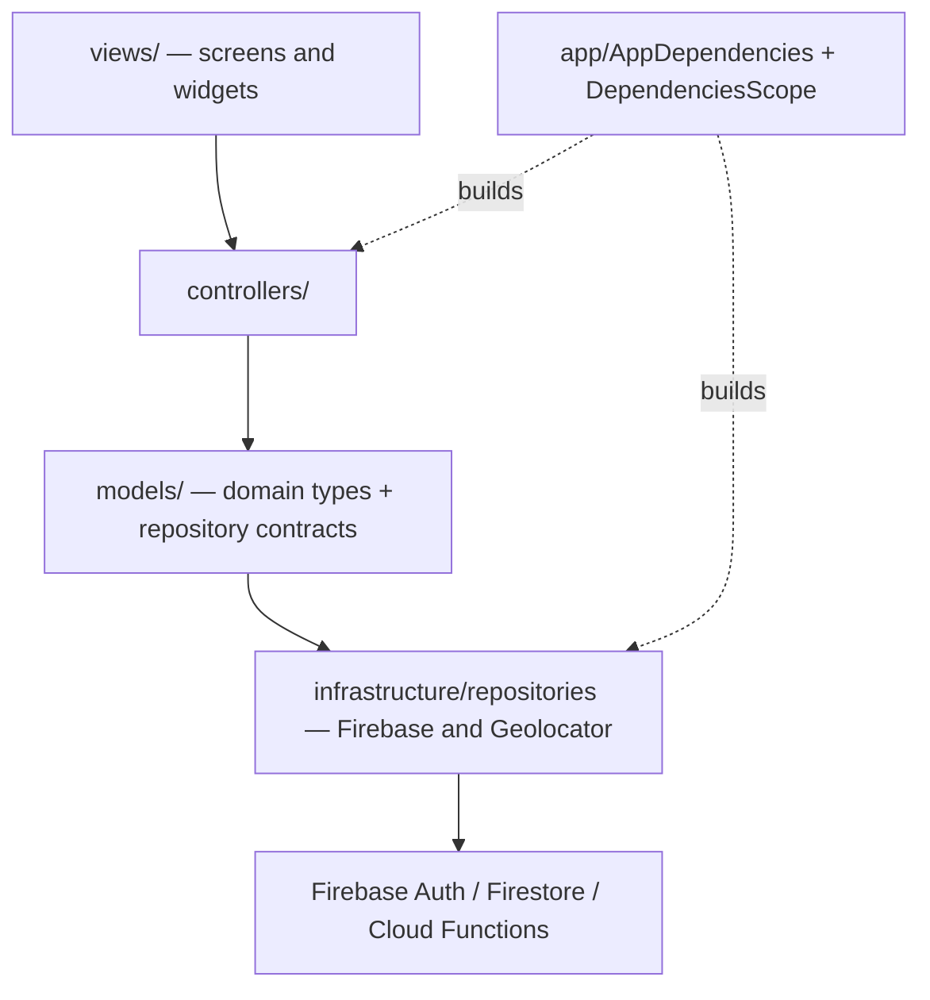

# Sprint 2 – Corrections
Course: ISIS-3510 – Construcción de Aplicaciones Móviles
Team: 13 – WhyNot
This page records the corrections to the Sprint 2 deliverable. The original
[Sprint 2 page](../sprint_2/Sprint2/sprint_2.md) is left unchanged, as required by the course
submission policy; every correction is documented here and referenced from the
Sprint 3 page.
---
## 1. Summary of Corrections
| Area | Sprint 2 page said | Corrected | Reason |
|---|---|---|---|
| BQ ownership | Several owners per BQ, different owners in sections 2 and 7 | One owner per BQ (section 2) | Each member must own and implement one BQ |
| Type 2 rationale | Described as administrator metrics | Linked to the user-experience improvement it drives | Type 2 = direct user-experience improvement |
| Analytics pipeline | Calculations inside each app (Kotlin ViewModels, Flutter controllers) | Every BQ computed in the backend (`get_admin_analytics`) and shown in the Admin Web | One definition per BQ; clients only write raw data |
| Kotlin architecture | Feature-first layers with ViewModels (MVVM-like) | MVC: `model`, `controller`, `view`, composition root in `AppDependencies` | Course target architecture, same as Flutter |
| Flutter architecture | Feature-first `presentation/application/domain/data` | MVC: `models`, `controllers`, `views`, `infrastructure` | Same target architecture in both apps |
| Design patterns | Several members per pattern; no pattern for Martín | One pattern per member (section 5) | Each member is responsible for one design pattern |
| Sensor | Microphone voice input | Geolocation | See section 6.1 |
| Admin screens | Inside both mobile apps | Removed from both apps (Kotlin PR #25) | Analytics are read from the Admin Web |
| Save This Product (Flutter) | Not implemented | Implemented (`save_recommended_product`) | Both clients now complete the BQ3 flow |
| Password requirements | Only a minimum length | Explicit rules and messages on sign-up and password change | Feedback on authentication UX |
---
## 2. Business Questions
One owner per BQ. The owner implemented the backend calculation and can explain
it; earlier client-side work by other members is kept as supporting history in
the original page.
| BQ | Business Question | Type | Owner | Platform | Rationale | Backend metric |
|---|---|---|---|---|---|---|
| BQ1 | How many products has a user saved? | Type 2 | Jerónimo Franco | iOS | Shows whether users actually adopt saving; a low count points to friction in the add-product flow, which the app can simplify. | `saved` (`dashboard_views.py`) |
| BQ2 | How many users save another product after their first one? | Type 2 | Juliana Durán | iOS | Measures repeated use; if users stop after one product, the experience after the first save must improve. | `saved` (`dashboard_views.py`) |
| BQ3 | How many recommended products have been saved? | Type 3 | Santiago Casasbuenas | iOS | Decides whether the Smart Recommendation feature is worth keeping and improving. | `recommended` (`dashboard_views.py`, `adminMetrics`) |
| BQ4 | Which category has the highest number of products marked as purchased per month? | Type 4 | Miguel Velandia | Android | Category demand over time is valuable to partner stores and brands. | `bq4` (`bq4_purchases_by_category.py`) |
| BQ5 | How many users have zero products saved? | Type 2 | Martín Riveira | Android | Users who never save need a better first-run experience; it motivates the Home empty state and activation flow. | `saved` (`bq5_zero_products.py`) |
| BQ6 | What is the demographic profile of the average buyer per category? | Type 4 | Juan Felipe Sáenz | Android | Buyer profiles per category are valuable to partners for targeting. | `bq6` (`bq6_demographics.py`) |

The six questions are the same ones defined in Sprint 1; only ownership and the Type 2 rationales were corrected.
---
## 3. Analytics Pipeline

Rationale.
- 
One calculation per BQ. In the original Sprint 2 page each app computed
  
the BQs itself, so the same question could get different answers on Kotlin
  
and Flutter. Now each BQ is one tested Python module behind
  
`get_admin_analytics`, and both apps only write raw facts.
- 
Security at the backend. The callable rejects any caller whose ID token
  
does not carry `admin: true`, so mobile clients never need permission to list
  
every user or product.
- 
Lighter apps. The mobile apps no longer download whole collections to
  
compute metrics.
Android (Kotlin)
| Member | Pipeline contribution |
|---|---|
| Juan Felipe Sáenz | Shared `get_admin_analytics` endpoint and admin authorization; BQ6 module |
| Miguel Velandia | BQ4 module; `purchasedAt` written by the one-way purchase |
| Martín Riveira | BQ5 module |

iOS (Flutter)
| Member | Pipeline contribution |
|---|---|
| Santiago Casasbuenas | BQ3 metric and Admin Web views |
| Juliana Durán | BQ2 calculation and documentation |
| Jerónimo Franco | BQ1 aggregation over real product data in Flutter, now served by the backend `saved` metric |
---
## 4. Architecture (MVC)
### 4.1 Kotlin / Android

Rationale. Screens never touch Firebase: each Route reads the controllers
from `LocalAppDependencies` and passes plain values to its Screen. Controllers
hold validation and business rules and depend only on repository interfaces,
so unit tests run them on fakes. `AppDependencies` is the single place that
chooses the implementations. The refactor from ViewModels to controllers was
done by Juan Felipe Sáenz (`656c4ce`, `1fae710`).
### 4.2 Flutter / iOS

Rationale. The same boundaries as Kotlin: widgets render and emit intents,
controllers own state and rules, infrastructure owns the SDKs. Reorganized
into MVC by Santiago Casasbuenas (`21b2b28`).
---

## 5. Design Patterns (one per member)

Android (Kotlin)
| Member | Pattern | Participating classes | How it is used |
|---|---|---|---|
| Juan Felipe Sáenz | Repository + Factory (AppDependencies) | `RecommendationRepository`, `NearbyStoreRepository` and their `Firebase*` implementations; `AppDependencies.firebase()` | Controllers depend on interfaces; `AppDependencies` builds the Firebase implementations and injects them; tests inject fakes. |
| Miguel Velandia | Observer + Adapter | `FirebaseProductRepository.observeProducts()` (`callbackFlow`), `StateFlow` in controllers; `AndroidLocationRepository` | Firestore snapshots push changes to every screen; Play Services location is adapted to `LocationRepository`. |
| Martín Riveira | Facade | `ProfileUpdateFacade`, used by `ProfileController` | One `save(...)` call checks the session, validates every field and writes the update. |

iOS (Flutter)
| Member | Pattern | Participating classes | How it is used |
|---|---|---|---|
| Santiago Casasbuenas | Dependency Injection | `AppDependencies`, `DependenciesScope` | Repositories passed to controllers through constructors. |
| Juliana Durán | Observer | `new_product_manual_screen.dart`: `addListener(_refresh)` on the product form fields | Every change in a field notifies the screen, which re-validates the form and redraws. |
| Jerónimo Franco | Repository | Contracts in `lib/models/repositories` and implementations in `lib/infrastructure/repositories` | Screens and controllers use the contracts; Firestore access stays in the implementations. |

---

## 6. Functionalities

### 6.1 Sensor: why the microphone was removed

The Sprint 2 page presented microphone voice input (product name and brand) as
the sensor feature. The team replaced it with geolocation as the single
sensor for both apps:
- 
Voice input added little value to the product: users usually type or paste a
  
short product name, and recognition errors still had to be fixed by hand.
- 
Geolocation was already required by the context-aware feature (Nearby
  
Stores), so one sensor now supports a real user goal on both platforms.
- 
Removing the microphone also removed the `RECORD_AUDIO` permission and its
  
privacy cost.
Removal commits: Kotlin `7a71779` (Miguel Velandia), Flutter `f87c6fc`
(Juliana Durán).
### 6.2 Updated status
| Requirement | Kotlin / Android | Flutter / iOS | Change from the Sprint 2 page |
|---|---|---|---|
| Sensor | Geolocation (`AndroidLocationRepository`) with permission and failure states | Geolocation (`GeolocatorLocationRepository`) | Microphone removed |
| Type 2 BQ functionality | Product-save attempts, onboarding and Home interaction events | Product-save and wishlist interaction events | Event tracking added |
| Context-aware | Nearby store and its detail view | Nearby store and its detail view | Detail views added |
| Smart feature | Recommendation, detail view and Save This Product | Recommendation, detail view and Save This Product | Flutter now saves recommendations |
| Authentication | Firebase Auth with password rules and live requirements checklist | Firebase Auth with improved validation messages | Password requirements added |
| External services | `get_recommendation`, `get_nearest_store`, `save_recommended_product` | Same callables | — |
| Admin analytics | Removed from the app; Admin Web | Removed from the app; Admin Web | Moved to the Admin Web |

---

## 7. Contributions by Area

Every table is split by platform: Android (Kotlin) and iOS (Flutter).

### 7.1 Business Question

See section 2: one BQ per member, with its platform.

### 7.2 Pipeline

See section 3: each member explains the pipeline of their own BQ.

### 7.3 Architectural Pattern

Android (Kotlin)
| Member | Contribution |
|---|---|
| Juan Felipe Sáenz | Kotlin MVC refactor (packages `app/model/controller/view`, controllers replacing ViewModels) |
| Miguel Velandia | Kotlin Firebase integration and the original layered structure and composition root |
| Martín Riveira | Home and navigation presentation consuming controller state |
iOS (Flutter)
| Member | Contribution |
|---|---|
| Santiago Casasbuenas | Flutter MVC reorganization and dependency composition |
| Juliana Durán | Product, recommendation and nearby flows on the controller/repository boundaries |
| Jerónimo Franco | Authentication, profile and analytics integration |
### 7.4 Design Pattern

See section 5: one pattern per member, split by platform.
### 7.5 GUI (views)

Android (Kotlin)
| Member | Views implemented |
|---|---|
| Juan Felipe Sáenz | Register, Login, Profile, Edit Profile and Change Password |
| Miguel Velandia | New Product |
| Martín Riveira | Home (wishlist previews, empty states, navigation to product flows) |

iOS (Flutter)

| Member | Views implemented |
|---|---|
| Santiago Casasbuenas | Edit Profile |
| Juliana Durán | New Product (manual): input validation, wishlist selection, product saving and error feedback |
| Jerónimo Franco | Login, Create Account, Home and Profile |

### 7.6 Feature

Android (Kotlin)
| Feature | Member | Implementation |
|---|---|---|
| Create Wishlist | Juan Felipe Sáenz | `WishlistController.createWishlist`: one wishlist per category, category must exist, picture link must be a web address, first wishlist recorded for onboarding |
| Create Product | Miguel Velandia | Product form available only when the user has a wishlist; validation of name, brand, price and wishlist |
| Edit Profile | Martín Riveira | `ProfileUpdateFacade`: session and owner checks, gender and age validation |

iOS (Flutter)

| Feature | Member | Implementation |
|---|---|---|
| Create Wishlist | Jerónimo Franco | `NewWishlistScreen` → `WishlistController` → `FirebaseWishlistRepository` |
| Create Product | Juliana Durán | Product creation requires an existing wishlist |
| Edit Profile | Santiago Casasbuenas | `EditProfileScreen` → `ProfileController` → `FirebaseUserRepository` |

### 7.7 Sensors (geolocation)

Android (Kotlin)
| Member | Contribution |
|---|---|
| Juan Felipe Sáenz | `NearbyStoreController` turns the device location into the nearby-store request |
| Miguel Velandia | `AndroidLocationRepository`: device coordinates and typed errors |
| Martín Riveira | Location permission, blocked-permission and location-off states |

iOS (Flutter)
| Member | Contribution |
|---|---|
| Juliana Durán | `GeolocatorLocationRepository` |
| Jerónimo Franco | iOS location permission description |
| Santiago Casasbuenas | Location error handling and recovery |

### 7.8 BQ Type 2

Android (Kotlin)
| Member | Front-end UX contribution |
|---|---|
| Juan Felipe Sáenz | Sign-up and first-wishlist onboarding events (`onboardingEvents`) and the `onboarding` funnel metric |
| Miguel Velandia | Product-save attempt events (`productSaveEvents`) and the `save_attempts` metric |
| Martín Riveira | Home empty-state and add-product navigation events (`uxEvents`) and the `home_activation` metric |

iOS (Flutter)
| Member | Front-end UX contribution |
|---|---|
| Juliana Durán | Product-saving flow that produces the BQ2 data |
| Santiago Casasbuenas | Wishlist interaction events and the `wishlist_interactions` metric |
| Jerónimo Franco | Product-saving activity behind BQ1 |
### 7.9 Context-Aware Feature (Nearby Stores)

Android (Kotlin)
| Member | Contribution |
|---|---|
| Juan Felipe Sáenz | `NearbyStoreController` and `FirebaseNearbyStoreRepository` calling `get_nearest_store` |
| Miguel Velandia | Device location and dependency wiring |
| Martín Riveira | Nearby Store detail view with its UI states |

iOS (Flutter)
| Member | Contribution |
|---|---|
| Juliana Durán | Nearby section, controller and repository |
| Jerónimo Franco | `get_nearest_store` Cloud Function (shared by both apps) and the Nearby Store detail view |
| Santiago Casasbuenas | Nearby error and retry behavior |

### 7.10 Smart Feature (Personalized Recommendations)

Android (Kotlin)
| Member | Contribution |
|---|---|
| Juan Felipe Sáenz | `RecommendationController` and repository; BQ3 save tracking in the backend; duplicate prevention through `recommendationEventId` |
| Miguel Velandia | First recommendation callable repository |
| Martín Riveira | Save This Product button and Recommendation detail view |

iOS (Flutter)
| Member | Contribution |
|---|---|
| Juliana Durán | Recommendation section, controller and repository |
| Santiago Casasbuenas | Save This Product with `save_recommended_product` |
| Jerónimo Franco | Recommendation detail view and its UI states |

### 7.11 Authentication

Android (Kotlin)
| Member | Contribution |
|---|---|
| Juan Felipe Sáenz | Login, Register, Profile, Edit Profile and Change Password views; password rules with a live checklist |
| Miguel Velandia | `FirebaseAuthRepository` and profile creation in Firestore |
| Martín Riveira | Authentication error handling and expired-session messages |

iOS (Flutter)
| Member | Contribution |
|---|---|
| Juliana Durán | Firebase Authentication integration |
| Santiago Casasbuenas | `AuthController`, repository boundary and route guards |
| Jerónimo Franco | Login and Create Account views; improved password messages |

### 7.12 External Services

Android (Kotlin)
| Member | Front → Back integration |
|---|---|
| Juan Felipe Sáenz | Repositories calling `get_recommendation`, `get_nearest_store` and `save_recommended_product`; `get_admin_analytics` |
| Miguel Velandia | Firebase repositories for authentication, profiles, wishlists and products |
| Martín Riveira | Save This Product through the existing callable |

iOS (Flutter)
| Member | Front → Back integration |
|---|---|
| Juliana Durán | Callables for recommendations and nearby stores |
| Santiago Casasbuenas | Backend function modules and the BQ3 aggregate |
| Jerónimo Franco | `get_nearest_store`, shared by both apps |

---
## 8. References
- 
[Original Sprint 2 page](./sprint_2.md)
- 
Kotlin: https://github.com/Moviles-G13-S1/whynot-front-kotlin
- 
Flutter: https://github.com/Moviles-G13-S1/whynot-front-flutter
- 
Backend: https://github.com/Moviles-G13-S1/whynot-back (analytics documented in `docs/admin-analytics.md`)
- 
Admin Web: https://github.com/Moviles-G13-S1/whynot-analytics-dashboard

