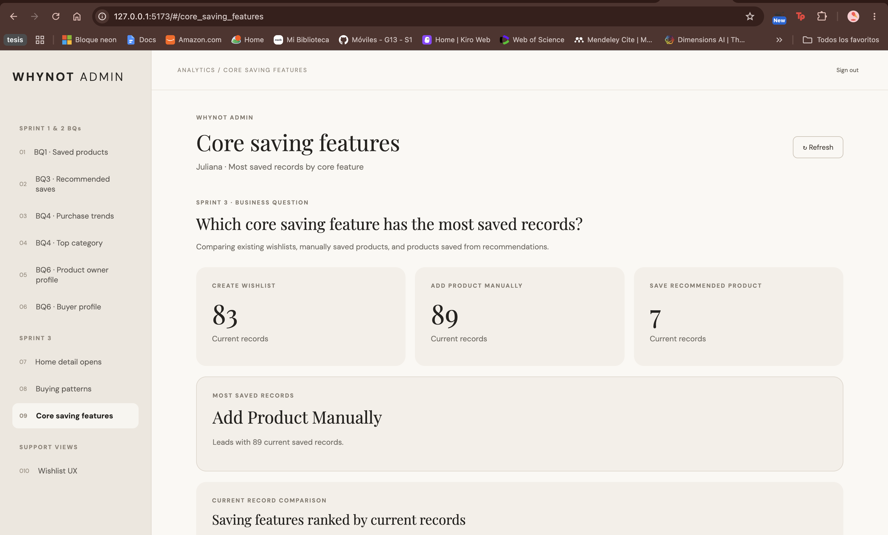
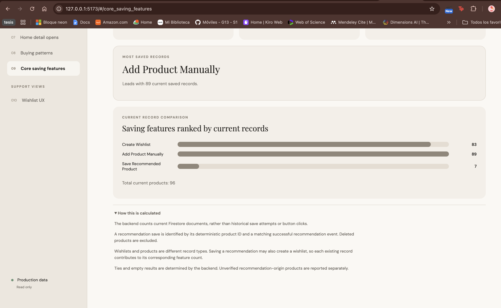

# Juliana's Sprint 3 Business Question

**Question:** Which of WhyNot's core saving features has the highest number of saved records?

This is a **Type 3** business question focused on comparing the use of WhyNot's core saving features. It identifies which functionality contributes the largest number of existing saved records, providing evidence to support future feature improvements.

The three compared features are **Create Wishlist**, **Add Product Manually**, and **Save Recommended Product**.

## Data contract

- The shared backend reads three Firestore collections: `wishlists`, `products`, and `productEvents`.
- **Create Wishlist** counts the number of existing documents in the `wishlists` collection.
- **Add Product Manually** counts existing product documents whose IDs do not use the recommendation-specific `rec_` prefix.
- **Save Recommended Product** counts existing products with a valid recommendation-generated ID and a matching successful recommendation event.
- Recommendation product IDs follow the deterministic format `rec_<SHA256(userId:sourceProductId)>`.
- Recommendation events must contain a valid `savedAt`, match the product owner, and reference the expected saved product ID.
- Unverified recommendation-origin products are reported separately rather than incorrectly classified as manual saves.
- Deleted products and wishlists are excluded because the metric counts current Firestore documents, not historical interactions.

## Calculation

The `core_saving_features` metric of `get_admin_analytics` (`functions/analytics/core_saving_features.py` in the backend) calculates the three feature counts.

- `wishlist`: number of existing wishlist documents.
- `manual_product`: number of existing manually saved products.
- `recommended_product`: number of existing products verified as saved recommendations.
- `highestCount`: maximum count among the three features.
- `leaders`: feature IDs with the highest count.
- `status`: `leader`, `tie`, or `empty`.
- `totalCurrentProducts`: total existing product documents.
- `unclassifiedProducts`: products whose recommendation origin cannot be verified.

Each Firestore document contributes at most once to its corresponding count. Recommendation events are used to verify the product origin but are not counted as separate saved records.

The calculation is performed entirely in the backend. The Admin Web displays the results in the **Core saving features** view (`src/core-saving-features-view.js`), including three KPI cards, the leading feature, a horizontal comparison chart, and the calculation methodology.

## Interpretation and limits

- This question measures **current saved records**, not button clicks, save attempts, or historical usage frequency.
- Wishlists and products are different record types, so their counts are compared but not added together as equivalent product records.
- A recommendation save may also create a wishlist. Each existing record contributes to its corresponding feature count.
- Deleted records no longer contribute to the metric.
- Products with an unverified recommendation origin are kept separate to avoid incorrect classification.
- The results reflect the database at the time the metric is requested and can change as users create or delete records.

## Evidence

The implementation includes backend unit tests in `tests/test_core_saving_features.py` and endpoint tests in `tests/test_core_saving_features_endpoint.py`, covering current record counting, duplicate events, recommendation validation, ties, empty databases, and admin authorization.

The Admin Web includes `test/core-saving-features-view.test.js`, covering the leading feature, ties, empty results, unclassified products, and invalid data. The Admin Dashboard PR reports **23/23 passing tests**, a successful production build, and validation in Chrome with real backend data.

On October 30, 2026, the signed-in Admin Web displayed the following production results:

| Core saving feature | Current saved records |
|---|---:|
| Create Wishlist | 83 |
| Add Product Manually | 89 |
| Save Recommended Product | 7 |

**Add Product Manually is the leading feature, with 89 current saved records.**

The database contains **96 current products**: 89 manually saved products and 7 products saved from recommendations. The 83 wishlists are counted separately.

The first screenshot shows the complete Admin Dashboard view with the three KPI cards, the business question, and the leading feature:

The second screenshot shows the horizontal comparison chart and the calculation methodology, demonstrating how the results are presented and explained to administrators:

Both screenshots show the Admin Web reading production data, rather than hardcoded examples.

Related work: Backend [PR #28](https://github.com/Moviles-G13-S1/whynot-back/pull/28) and Admin Web [PR #7](https://github.com/Moviles-G13-S1/whynot-analytics-dashboard/pull/7) are merged.
