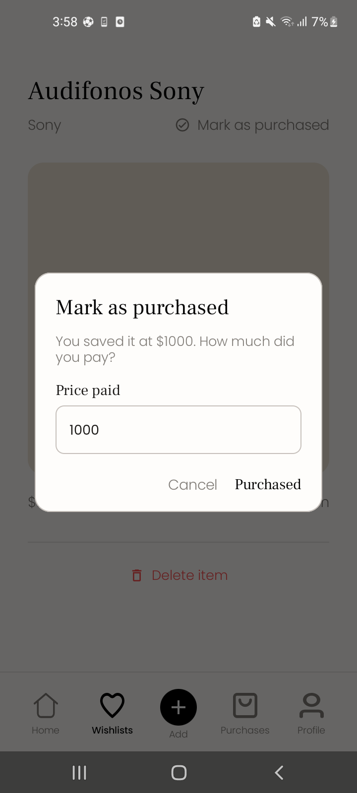
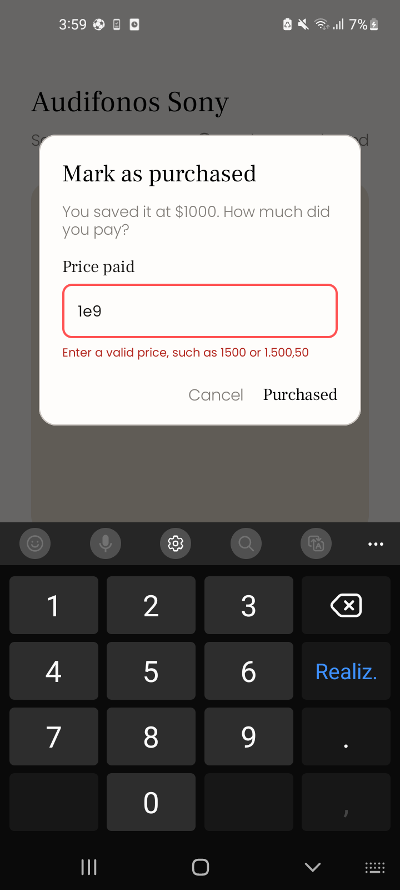
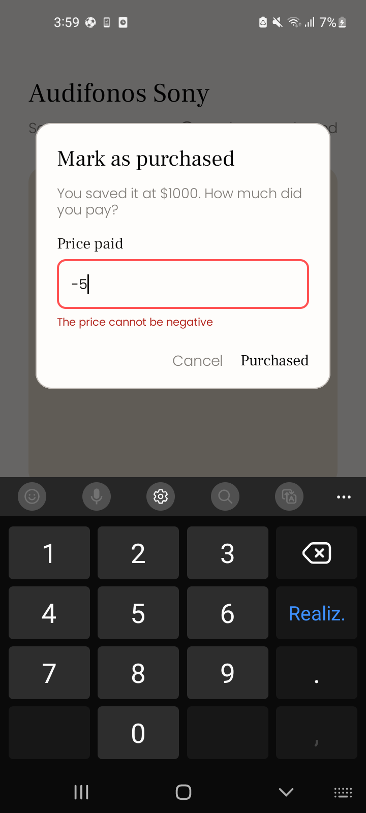
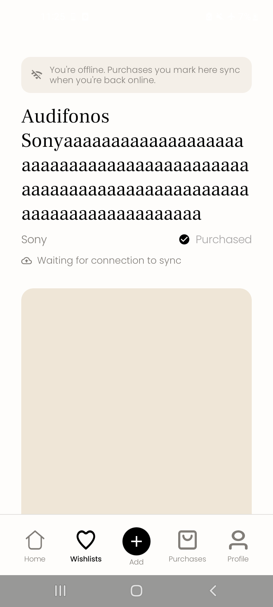
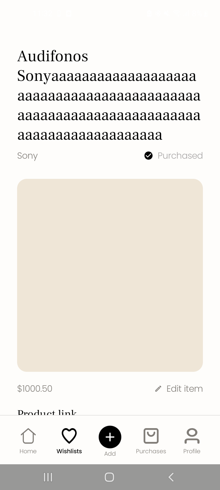
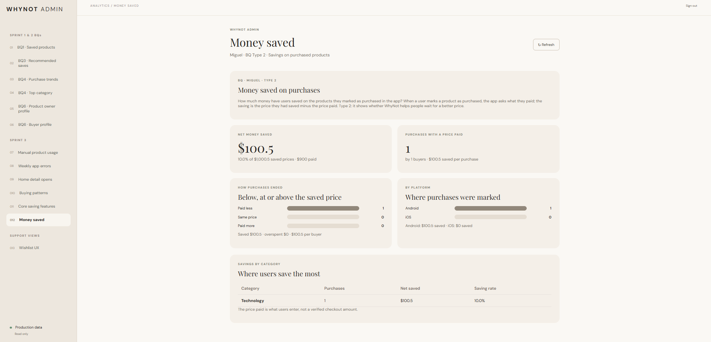

# Miguel's Sprint 3 Business Question

**Question:** How much money have users saved on the products they marked as purchased in the app?

This is **Type 2**, a direct improvement of the user experience: it shows whether people actually pay less than the price they saved, that is, whether WhyNot helps them wait for a better price, and in which categories it helps most. The saved product price alone cannot answer it, so the app records the price paid at the moment of purchase.

## Data contract

- On Android, **Mark as purchased** in Product Detail opens `PurchasePriceDialog`, filled in with the saved price, and asks "How much did you pay?". The value follows `PriceRules`: digits and separators only (`1.000`, `1,000.50` and `1.500,50` are read as people mean them), greater than 0, at most 100.000.000 and 2 decimals. `NaN`, `Infinity`, `1e9`, `0` and negative values are rejected under the field.
- `ProductController.markPurchased` marks the product as purchased and then, in the background, `FirebaseProductRepository.recordPurchase` writes `productPurchaseEvents/{productId}` with `userId`, `productId`, `categoryId`, `referencePrice` (the saved price), `purchasePrice` (the price paid), `platform` and a server `createdAt`.
- The Firestore rules accept the event only when the caller owns the product, the product is already purchased, `referencePrice` and `categoryId` equal the product's own values, both prices are numbers of at least 0, `platform` is `android` or `ios`, and `createdAt` is the request time. The document id is the product id, so each product has one event. Events cannot be updated or deleted, and only admins can read them.
- Offline, Firestore applies the purchase locally and queues it; the product shows "Waiting for connection to sync" until the backend confirms it (see the [connectivity evidence](sprint_3_wiki.md#23-evidence), scenario D).

## Calculation

The `purchase_savings` metric of `get_admin_analytics` (`functions/analytics/purchase_savings.py` in the backend) reads every event:

- saving of one purchase = `referencePrice` − `purchasePrice`; it is negative when the user paid more than the saved price;
- **`netSaved`**, the sum of every saving, is the answer to the question; overpaying offsets savings;
- `grossSaved` and `overspent` keep the positive and negative parts apart, and `savingRate` is `netSaved` as a percentage of the total reference price;
- it also returns purchases and buyers, averages per purchase and per buyer, how many purchases were paid less, the same or more, and the figures per category and per platform. Events without a valid price are left out and counted in `skipped`.

The Admin Web shows it in the **Money saved on purchases** view (`src/purchase-savings-view.js`).

## Interpretation and limits

- The price paid is what the user types; it is not a verified checkout amount.
- Only purchases marked after this event existed (Sprint 3) are counted; older purchases have no price paid.
- Events are history: deleting the product later does not remove its saving.

## Evidence

Backend: 8 unit tests in `tests/test_purchase_savings.py`, the metric registered in `tests/test_admin_analytics.py`, and 4 Firestore rules tests for `productPurchaseEvents` with the emulator. Admin Web: 4 tests in `test/purchase-savings-view.test.js` and a successful production build. Android: the price paid and its validation are covered by `ProductDraftAndOfflineTest` and `PriceRulesTest`; all 103 Kotlin tests pass.

On a Samsung Galaxy A21s (SM-A217M) with the Demo account, the dialog asks for the price paid and rejects invalid values under the field:

  

A purchase marked offline waits for the connection and is confirmed after reconnecting:

 

On October 30, 2026, the signed-in Admin Web, reading production data from `whynot-f4ae6`, showed **$100.5 net saved** on 1 purchase by 1 buyer: the product marked as purchased offline on the Demo account the day before, saved at $1,000.5 and paid $900 (10.0% saving rate, Android, Technology). The event reached Firestore after reconnecting and the metric calculated it, which confirms that the `productPurchaseEvents` rules and `get_admin_analytics` with `purchase_savings` are deployed.

Related work: Kotlin [PR #29](https://github.com/Moviles-G13-S1/whynot-front-kotlin/pull/29), backend [PR #29](https://github.com/Moviles-G13-S1/whynot-back/pull/29), Admin Web commit [`09d6305`](https://github.com/Moviles-G13-S1/whynot-analytics-dashboard/commit/09d6305).
