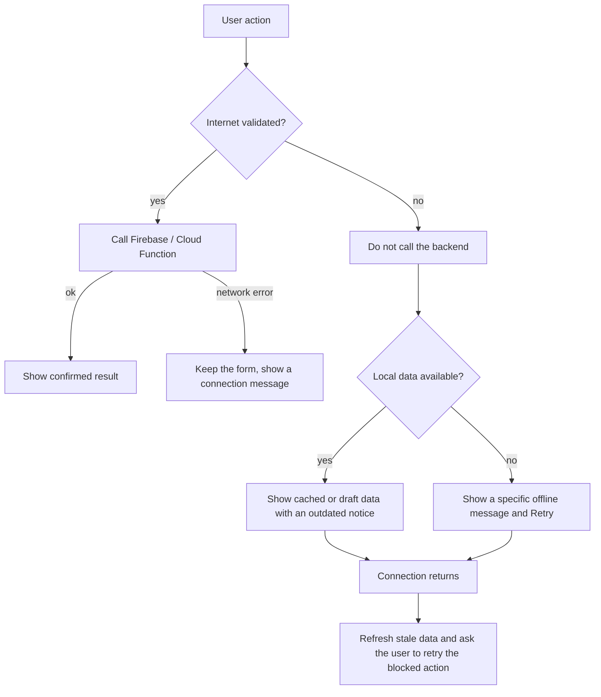

# Sprint 3 – App Implementation and Definition
ISIS-3510 Construcción de Aplicaciones Móviles · Team 13 – WhyNot
Corrections to the Sprint 2 deliverable are documented in [Sprint 2 – Corrections](../sprint_2/Sprint2/correcciones_sprint_2.md). The original Sprint 2 page is unchanged.
Teams: Android (Kotlin) is Juan Felipe Sáenz, Miguel Velandia and Martín Riveira. iOS (Flutter) is Juliana Durán, Santiago Casasbuenas and Jerónimo Franco.
---
## 1. Sprint 2 features and changes
All Sprint 2 features are part of this delivery. The changes made since the Sprint 2 page are listed in the corrections page linked above: MVC architecture, backend analytics behind `get_admin_analytics`, geolocation as the only sensor, admin screens removed from both apps, password rules, and the Flutter Save This Product flow.
| Sprint 2 improvement | Android (Kotlin) | iOS (Flutter) |
|---|---|---|
| Product creation requires an existing wishlist | Miguel | Juliana |
| Save This Product | Martín | Santiago |
| Password validation messages | Juan Felipe | Jerónimo |
| Emojis, icons and UI behavior | Miguel | Santiago |
| Recommendation and Nearby Store detail views | Martín | Jerónimo |
| Microphone removed | Miguel | Juliana |
| Admin screens removed | Juan Felipe | Santiago |
| Cross-platform functional testing | Martín | Juliana |
---
## 2. Eventual connectivity
### 2.1 Scenarios
| Scenario | Situation | Expected behavior |
|---|---|---|
| A | Connection lost while viewing existing data | The screen keeps the data that is already available and shows that it may be outdated. |
| B | Connection lost during product creation | The typed values are kept as a local draft. The draft is not shown as a saved product. The user can retry when the connection returns. |
| C | Smart or context-aware service unavailable | A specific error is shown, a previously cached result is shown when there is one, and a retry action is offered. |
| D | Connection restored | Stale information is refreshed, the pending operations that are explicitly supported are processed, and the confirmed result is shown. |

Rationale. Firestore offers offline persistence, but it only covers reads and queued writes of documents. It does not keep a form draft, does not protect the Cloud Function calls (recommendations, nearby stores) and does not tell the user what is happening. For that reason each functionality defines its own behavior and message instead of relying only on the built-in persistence. Local drafts are never described as synchronized Firestore products.
### 2.2 Strategy per functionality
Android (Kotlin)
| Functionality | Owner | Offline behavior |
|---|---|---|
| Login, register and change password | Juan Felipe | The backend is not called without internet and an offline notice is shown. The typed fields are kept; passwords are kept only in memory. Firebase network errors show a "No connection" message without clearing the form. |
| Profile | Juan Felipe | The profile is served from the Firestore cache with an offline notice. Saving the profile is blocked while offline and the typed values are kept. |
| Smart recommendations | Juan Felipe | The last cached recommendation is shown as stale with a Retry action. It refreshes only when the connection returns. |
| Create product, product detail and purchases | Miguel | The New Product form is kept as a draft. Wishlists, products and purchases are available offline, and the pending states are shown. |
| Home | Martín | TODO(Martín): offline states of Home and navigation. |
| Nearby stores | Martín | TODO(Martín): Nearby Store errors and retry. |
iOS (Flutter)
| Functionality | Owner | Offline behavior |
|---|---|---|
| Create product | Juliana | Product drafts are stored in SQLite, one per wishlist, and restored without internet. |
| Smart recommendations | Santiago | Cached recommendations are shown, expired results are identified and a retry is offered. |
| Nearby stores | Santiago | Failures of the Nearby service show a specific message and a retry. |
| Login and registration | Jerónimo | Authentication error states for the cases without internet. |
| Home | Jerónimo | Home shows what is available and the state of each section. |
| Profile | Jerónimo | Profile recovery after a failed load or update. |
Note. On iOS the wishlist and product detail screens rely on Firestore persistence and do not have their own offline message.
### 2.3 Evidence
TODO(team): screenshots of the app in airplane mode for scenarios A to D, on both platforms.
---
## 3. Functionalities and technical strategies
### 3.1 Features delivered
| Functionality | Android (Kotlin) | iOS (Flutter) |
|---|---|---|
| Authentication and profile | Juan Felipe, Miguel | Jerónimo, Santiago |
| Product creation and management | Miguel | Juliana |
| Wishlist management | Miguel, Juan Felipe | Juliana, Jerónimo |
| Smart recommendations | Juan Felipe, Miguel | Juliana, Santiago |
| Context-aware nearby stores | Juan Felipe, Miguel | Juliana, Jerónimo |
| Home and navigation | Martín | Jerónimo |
| Analytics dashboard (Admin Web) | Shared backend and BQ owners | Shared backend and BQ owners |
### 3.2 Business questions of Sprint 3
These questions are different from the Sprint 2 ones. Each one is calculated in the shared backend behind `get_admin_analytics` and shown in the Admin Web. Types follow the course definition: Type 1 telemetry of the app, Type 2 direct improvement of the user experience, Type 3 new or updated features, Type 4 benefits from data, and Type * a combination.
| Owner | Platform | Business question | Type | Rationale |
|---|---|---|---|---|
| Juliana | iOS | Which core saving feature has the most saved records? (Create Wishlist, Add Product Manually or Save Recommended Product) | Type 3 | Shows which saving feature users rely on, to decide which one to improve. Backend metric `core_saving_features`. TODO(Juliana): confirm the type. |
| Jerónimo | iOS | How many errors does the app produce weekly? | Type 1 | Weekly error counts show the technical health of the app. Backend metric `weekly_app_errors` and Admin Web view are done. The error events written by the app are in PR #33, still open. |
| Santiago | iOS | What percentage of the recommendations shown on Home are opened in the detail view? | Type 3 | It tells whether the recommendation detail view is useful and easy to find. Backend metric `recommendation_home_opens`. |
| Miguel | Android | How much money have users saved on the products they marked as purchased? | Type 2 | Users see the benefit of the app. The price paid is asked when marking a purchase. Backend metric `purchase_savings`. |
| Martín | Android | How often do users add a product manually? | Type 3 | It shows how much manual entry is used compared with saving a recommendation. TODO(Martín): backend metric and Admin Web view. |
| Juan Felipe | Android | What are the buying patterns of users based on the products they marked as purchased? | Type * (2 and 4) | Time to purchase and purchase hours help reminders (Type 2). Conversion, price and brands per category help stores and brands (Type 4). Backend metric `buying_patterns`. |
### 3.3 Technical strategy per member
| Member | Platform | Primary strategy | Main functionality |
|---|---|---|---|
| Juliana | iOS | Local storage | Products and wishlists |
| Santiago | iOS | Caching | Recommendations |
| Jerónimo | iOS | Concurrency | Home and profile |
| Miguel | Android | Local storage | Products and wishlists |
| Juan Felipe | Android | Caching | Recommendations and images |
| Martín | Android | Concurrency | Home and navigation |
Eventual connectivity is shared by all members, according to the functionalities in section 2.2.
### 3.4 Local storage
Android (Kotlin), Miguel. Jetpack DataStore keeps the New Product form as a draft, associated with the current user. The draft is restored after restarting the app and is cleared when the product is saved. It is separate from the confirmed Firestore writes. Firestore persistent cache (50 MB) is configured in `AppDependencies` so wishlists, products and purchases can be read without internet.
iOS (Flutter), Juliana. SQLite (`sqflite`) keeps the product draft: name, brand, price, image URL and product URL, one draft per wishlist and per authenticated user (`SqliteProductDraftStore`). The draft is restored when the user returns and cleared after the product is created. A draft does not count as a saved product.
Jerónimo's error events (BQ7) that cannot be sent are kept in a SQLite queue on iOS and sent later (PR #33, still open).
Why. A product form is long, and losing it because of a lost connection or a restart is the main frustration of the create-product flow. A small local store solves it without changing the Firestore data.
### 3.5 Multithreading
Android (Kotlin), Martín. The app already uses coroutines: `callbackFlow` and `StateFlow` for Firestore data, suspend functions in the repositories and an application scope with `SupervisorJob` in `AppDependencies`. TODO(Martín): the strategy planned for Home (`async` / `await` for independent operations and `Dispatchers.IO`) is not implemented yet.
iOS (Flutter), Jerónimo. Home and Profile load their independent sections without waiting for each other: each section is a `LiveSection` that subscribes to its own data and keeps its own loading, success and error state with its own retry. The profile photo is resolved without blocking the first profile result. The interface stays responsive while each section loads.
Why. A slow request in one section should not delay the rest of the screen.
### 3.6 Caching
Android (Kotlin), Juan Felipe.
- 
`RecommendationCache` is an Android `LruCache` per authenticated user (uid): at most 5 entries and a time to live of 30 minutes. It counts hits, misses, expirations and evictions, and writes them to Logcat with the tag `WhyNotCache`.
- 
`RecommendationController` reads the cache first. Without internet, or if the backend fails, it shows the last recommendation marked as stale with a Retry action, and it refreshes when the connection returns.
- 
The cache is invalidated when a recommendation is saved and when the profile is edited, and it is cleared on sign out.
- 
Coil 3.2.0 loads images with a global memory cache (25% of the available memory) and a disk cache (50 MB). A custom User-Agent was needed because some image hosts blocked the default one.
iOS (Flutter), Santiago.
- 
A per-user LRU cache of recommendation results with a maximum capacity and an expiration time, plus a cache of the catalog snapshot and of the five recently opened products.
- 
Entries are invalidated when the saved categories change.
- 
`cached_network_image` caches product images, and the profile photo has its own cache.
Why. The recommendation is a Cloud Function call with a visible delay, and the same user often opens Home several times in a session. The cache avoids repeating the call and gives something to show when there is no internet.
---
## 4. Application sharing
| Task | Responsible |
|---|---|
| iOS real-device test and coordination with the TAs | Juliana |
| Android real-device test | Miguel, Martín |
| APK through Firebase App Distribution to the seven TAs | Juan Felipe |
| Message in the Microsoft Teams general channel | Juan Felipe (Android), Juliana (iOS) |
| Cross-platform regression testing | Juliana, Martín |
---
## 5. Who explains what
Every member explains the strategies of the other members of the same platform.
Android (Kotlin)
| Member | Own strategy | Also explains |
|---|---|---|
| Miguel | Local storage | Juan Felipe's caching and Martín's concurrency |
| Juan Felipe | Caching | Miguel's local storage and Martín's concurrency |
| Martín | Concurrency | Miguel's local storage and Juan Felipe's caching |
iOS (Flutter)
| Member | Own strategy | Also explains |
|---|---|---|
| Juliana | Local storage | Santiago's caching and Jerónimo's concurrency |
| Santiago | Caching | Juliana's local storage and Jerónimo's concurrency |
| Jerónimo | Concurrency | Juliana's local storage and Santiago's caching |
